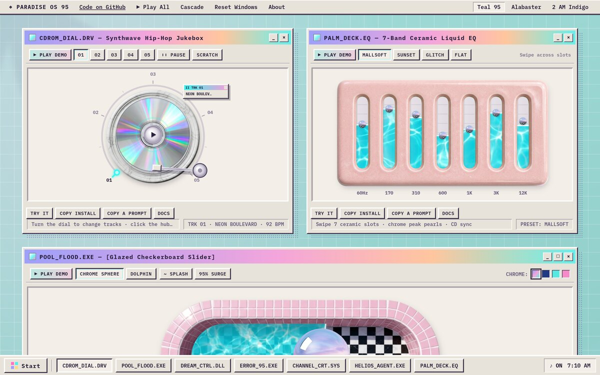

# Paradise OS UI

Ordinary UI controls built out of photographed parts from a 1995 that never quite happened. The music player is a holographic CD you turn to change the song. The equalizer is pool water in a pink ceramic rack. The slider floods a tiled pool. The tabs are three beige CRT monitors floating in the air, and the agent status is a marble bust that comes apart while it thinks.

Each control is a single file that defines a custom element, with its photographs and fonts inside it, so there is nothing else to fetch. Under each drawing is a real control, so they work with a keyboard and a form. No dependencies, no build step for you, MIT licensed.



## The seven

| | element | what it does |
|---|---|---|
| [CD-ROM jukebox](cd-dial/) | `<paradise-cd-dial>` | A five-track music player. Turn the disc and it clicks to the next track and plays it; click the hub to play or pause. |
| [Equalizer](eq/) | `<paradise-eq>` | Seven slots of pool water in a pink ceramic rack. Swipe across to paint the curve; with music on, the water dances to it. |
| [Pool slider](slider/) | `<paradise-pool-slider>` | The value is how full the pool is. Drag the chrome ball and the water floods after it in waves; past 85% it overflows. |
| [Dream toggle](toggle/) | `<paradise-toggle>` | A switch between paradise and reality. Off, every Paradise control on the page drains to grey wireframe. |
| [Cascade button](button/) | `<paradise-cascade-button>` | An error dialog you press. Click and copies cascade down like dealt cards; hold to charge a hypercube for a bigger cascade. |
| [CRT tabs](tabs/) | `<paradise-crt-tabs>` | Three floating monitors. Pick one and it powers on to its channel while the others collapse to a dot. |
| [Statue agent status](agent-status/) | `<paradise-statue>` | A marble bust in 3D that shows what an AI agent is doing: thinking, searching, writing, error, done. |

## The look

Each control is one 1995 object doing the control's job, on a pale stone page inside a 95-era window: bevelled grey frames, pink-to-teal title bars, IBM Plex Mono labels. The objects are studio photographs, cut out and drawn on a canvas; everything that moves (water, glow, cards, the laser arm) is drawn in code and moves on springs, so it clicks into detents, overshoots and settles.

The controls share a page. One clock drives them all, the equalizer follows whatever the CD dial plays, the statue's error makes the others flinch, and the dream toggle turns them all to grey wireframe reality and back.

Each one makes small synthesized sounds (clicks, chimes, splashes, a degauss thunk) after the first tap on the page. The CD dial's five songs are real recordings, made with ElevenLabs Music for this set and kept in `audio/`.

## Try them

Live: https://paradise-os-ui.vercel.app

Or run it yourself:

```sh
python3 -m http.server 8000     # from this folder
# open http://localhost:8000/
```

That opens the gallery, a desktop with all seven in windows.

## Use one

Each is a single file that defines an element. Install it with the shadcn CLI, which puts the file in `public/paradise-os-ui/`:

```sh
npx shadcn add finktheartist/paradise-os-ui/cd-dial
npx shadcn add finktheartist/paradise-os-ui/eq
npx shadcn add finktheartist/paradise-os-ui/slider
# ...toggle, button, tabs, agent-status
```

Or copy the file. Then load it with a plain script tag and use the element:

```html
<script src="slider.js"></script>
<paradise-pool-slider value="62" name="level"></paradise-pool-slider>
```

For the CD dial's songs, copy `audio/` too and point the dial at it: `<paradise-cd-dial tracks="audio/">`. Without it the dial plays synthesized beats.

Every control's own README has its attributes, properties, events and what it does beat by beat.

## Make your own

[`skills/paradise-os-ui/`](skills/paradise-os-ui/) is the workflow the set was made by, as a skill for a coding agent (`npx skills add finktheartist/paradise-os-ui`): the shared core, the rules the set follows, `starter.html` (the smallest whole control, to copy) and `look.mjs`, which stops the clock and saves an interaction frame by frame so you can check it. How the set was made, and every prompt for its pictures and songs, is in [making-of/](making-of/).

## Working on this repo

The component files are built; edit their parts and rebuild.

- `core.js` is the shared core and `src/sound.js` the sound engine; `src/elements/<id>.js` is each control; `art/` holds the plates and `fonts/` the two fonts.
- `tools/spec.mjs` describes every control once. `node tools/build.mjs` stamps each `<id>/<id>.js` from the parts; `node tools/docs.mjs` writes every control's README and demo page, `registry.json`, `llms.txt` and the gallery's copy buttons. Both take `--check`.
- `node tools/test.mjs [URL]` drives every control in the gallery with real touch and key events at phone width and checks form values and sideways scroll. `node tools/shot.mjs` retakes the title image.
- The gallery (`gallery/index.html`) is the original desktop page and is edited by hand.

## Limits

- **Fixed sizes.** Each control draws at one size (between 244 × 98 and 560 × 225 pixels). The gallery and demo pages zoom wide ones down on a phone; do the same with CSS `zoom` in your page.
- **Drawn for a light page.** The photographs are cut from white and their shadows assume a pale background.
- **Heavy for a control.** The photographs make each file 150 to 550 KB; load only the ones you use.
- **The equalizer has no keyboard control yet,** and its values are not sent with a form.
- **The statue needs WebGL** for its 3D bust; without it a flat picture stands in.
- **Checked in headless Chromium** with real mouse, touch and key events. Not tried in Safari or Firefox, on a real phone, or with a screen reader.

## License

MIT for the code and the pictures. The two fonts, IBM Plex Mono and Plus Jakarta Sans, are under the SIL Open Font License (see `fonts/`). The five songs in `audio/` were made with ElevenLabs Music for this set; check ElevenLabs' terms before using them elsewhere.
