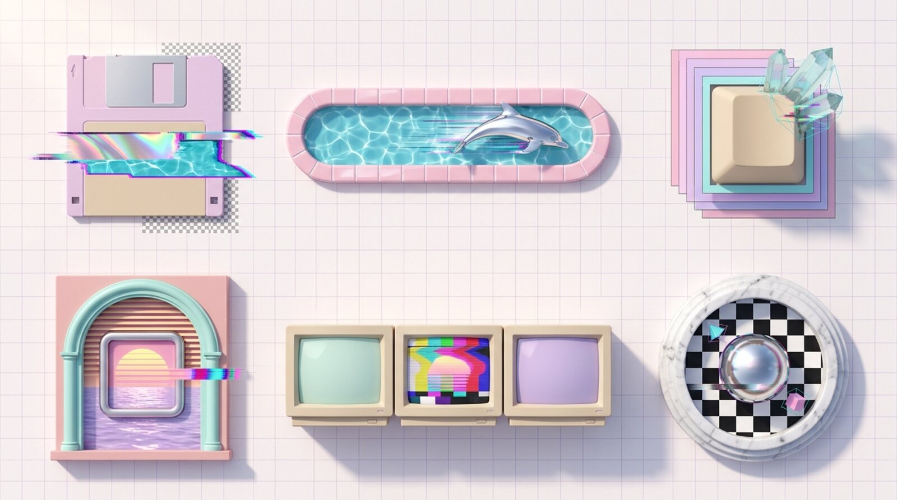

# How Paradise OS UI was made

Paradise OS UI was built over one long session in November 2026, mostly by Gemini working in the Antigravity coding agent and finished by Claude. Justin Finkelman directed it. This is how it went, and what changed along the way. Every prompt for the pictures and songs is in [prompts.md](prompts.md).

## Concepts

It started as a question: how would you design a vaporwave UI set? Gemini made three rounds of concept sheets (tape decks, classic vaporwave artifacts, then "glitch paradise"), and the pick was the glitch objects family: ordinary controls made from vaporwave things, a floppy, a pool with a dolphin, a keycap with quartz, a sunset arch, three little CRTs and a checkerboard pearl.

## Flat, then photographed

The first build drew everything with canvas gradients. The note back was "these feel really flat and unintuitive". So every hero object became a plate: a studio photograph of the part, generated on a plain white or green background, cut out to transparency with ImageMagick and drawn on a canvas. Code only draws what moves on top of it: water, glow, labels, particles. That is the rule the whole set follows now: the parts are photographs, the motion is code.

The pool slider's water is a small shallow-water simulation (a row of springs), so a fast drag throws a wave down the pool. Everything else moves on springs too, which is where the detents, overshoots and settles come from.

## The statue

The agent status started as an orb. "Can the agent state be a floating statue", then "I would like the statue to rotate a little bit slowly". A flat picture of a bust cannot turn, so Gemini generated a depth map of the bust and the core draws it as a real 3D mesh in WebGL, cut into four slabs (crown, face, neck, shoulders). That is what lets each state take it apart differently: thinking spreads the slabs, searching scans a laser down them, done slams the whole bust into the plinth. A later pass, asked to make it "more dynamic and robust" with a "WOW factor", made each state look more different from the others.

## More desktop

"Can we give more of the windows interface vibes too. The floppy disk, the quartz are pretty boring." The floppy and keycap controls were dropped (they are not in this repo) and the set moved to the 95-era desktop: the toggle became a little dialog window (PARADISE.SYS), the button became an error dialog that cascades copies of itself, the gallery became a desktop with windows, a menu bar and a taskbar.

The CRT tabs went through three notes: "the monitors should be floating and rotating too like they are all suspended", then "no strings", then a hairline plane that showed at the base of a monitor in certain states, which was fixed.

## The jukebox

The last two controls were a CD-ROM dial and an equalizer, joined through the shared sound engine. The dial first changed playback speed; then: "make the disc the first one and when you move the dial it switches tracks to synthwave hip hop generated songs". Five songs were made with ElevenLabs Music, one per track, each written for its tempo and key (prompts in [prompts.md](prompts.md)). Turning the disc now changes the song the moment it lands, and the equalizer's water follows the music.

Two bugs from that pass are worth knowing about. Each track change fired twice (the element set its own `track` attribute, which re-entered the change and could restart the song); it now fires once. And a teal focus ring circled the whole dial while you turned it; the ring now shows only for the keyboard.

## Packaging

For this repo the page was split into one file per control. Each file carries the shared core (clock, springs, the element base class, the bus, the drawing helpers), the sound engine, the plates it draws and two fonts, all stamped in by `tools/build.mjs`, so it works alone. Two things changed on the way:

- **The songs are not stamped in.** They load from a folder (`tracks="audio/"`); with no folder, each track is a beat synthesized in the browser.
- **Pointer maths divides by scale,** so a control zoomed down to fit a phone still lands your finger where you put it.

Brand names (real operating systems, monitors, card games) were taken out of the labels and titles; the world is 95-era, not a product.
